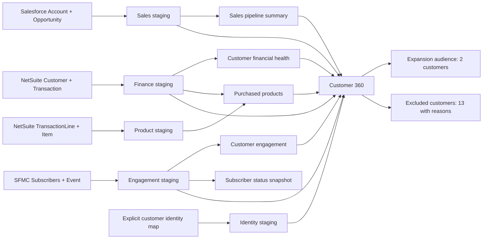

# Supaflow customer expansion demo

A complete Snowflake dbt project: turn Salesforce sales history, NetSuite invoice
balances and purchased products, and SFMC engagement into an explainable customer
expansion audience. All 230 seed records are synthetic. The optional DEV activation
writes only the two eligible synthetic customers to an SFMC Data Extension and
ends with a draft journey and subscriber email preview. No email is sent.

The deterministic fixture has 15 customer scenarios. **Northstar Demo Labs** and
**Orchard Demo Industries** qualify for the analytics add-on. The other 13 customers
have explicit exclusion reasons, including overdue invoices, absent engagement,
suppressed subscribers, missing identity matches, and an existing add-on purchase.

## DAG



There are 9 staging views, 4 intermediate views, 3 final tables, and 1 subscriber
status snapshot. Each fact is aggregated independently before joining at customer
grain. Multiple opportunities, invoices, lines, and events deliberately exercise
fan-out protection. The DAG in dbt uses seed references so a single `dbt build`
also works in an empty demo namespace. Declared sources describe the same landing
tables and support `dbt source freshness`.

## Run locally

Use Python in a virtual environment with `dbt-snowflake` (validated with dbt Core
1.12.0 and dbt-snowflake 1.12.0). `requirements.txt` pins the tested dbt
versions and includes PyYAML for optional fixture regeneration. No dbt packages
are required. For a fresh local environment:

```sh
python3 -m venv .venv
source .venv/bin/activate
python -m pip install -r requirements.txt
```

Copy `profiles.yml.example` to a private profiles directory as `profiles.yml` and
provide its `DEMO_SNOWFLAKE_*` environment variables through your secret mechanism.
Do not commit a populated profile. The Snowflake CLI connection used for local
validation is `dev`; dbt uses profile **supaflow_customer_demo**, target **dev**.
dbt does not automatically read the Snowflake CLI connection.

Use database **SUPA_DB** and a dedicated target schema **SUPAFLOW_DEMO**, or
**SUPAFLOW_DEMO_<SUFFIX>** for a separate capture run. The guard rejects other
namespaces. The role needs warehouse usage, database usage, schema creation, and
permission to create tables/views in those dedicated schemas.

With your private profile selected through `DBT_PROFILES_DIR`:

```sh
export DBT_PROFILES_DIR=/path/to/private/profiles
dbt debug
dbt deps
dbt parse
dbt list --resource-type model
dbt compile
dbt seed --full-refresh
dbt run --full-refresh
dbt snapshot
dbt test
dbt build --full-refresh
dbt source freshness
dbt docs generate
dbt show --select expansion_audience --limit 10
dbt show --select demo_results --limit 10
dbt show --select excluded_customers --limit 20
```

For the complete repeatable check, run `bash scripts/validate.sh`. It stops on the
first failed command. `dbt deps` exits successfully with a no-packages warning
because the project deliberately has no external packages. `dbt docs generate`
creates `target/index.html`, `manifest.json`, and `catalog.json` for a docs viewer.

`dbt build` alone runs seeds, models, snapshots and tests in dependency order.
The longer sequence also exercises the individual commands used in the product
demo. Full refresh deliberately recreates this project's seed and model tables;
use only a dedicated namespace. Routine data reseeding can use `dbt seed` without
full refresh, followed by `dbt build`. Rerun after a failure: operations across
multiple relations are not one atomic transaction.

### Import into Supaflow from Git

1. Create a dbt project from this repository's Git URL, with project directory `.`.
2. Select the Snowflake connection for `SUPA_DB` and configure target schema
   `SUPAFLOW_DEMO` (or a dedicated `SUPAFLOW_DEMO_VIDEO` namespace).
3. Run `dbt debug`, `dbt seed`, and `dbt build`.
4. Inspect the model DAG and open `models/marts/customer_360.sql` to explain the
   eligibility rules. The fixture's as-of date is fixed, so previews stay repeatable.
5. Run `dbt show --select demo_results --limit 10` for the short audience table,
   then `dbt show --select excluded_customers --limit 20` for explainable exclusions.

The exact Supaflow Git-import sequence will be validated separately in the product.
This repository's local validation establishes that the dbt project itself works.

## Expected outputs

| Relation | Rows | Purpose |
| --- | ---: | --- |
| `CUSTOMER_360` | 15 | Unified customer profile and eligibility decision |
| `EXPANSION_AUDIENCE` | 2 | Attributes for the analytics expansion activation |
| `EXCLUDED_CUSTOMERS` | 13 | First applicable exclusion reason and supporting facts |
| Subscriber status snapshot | 15 current | Tracks subsequent changes to subscriber status and email |

| Customer | Paid invoice amount (USD fixture) | Overdue amount | Recommended product |
| --- | ---: | ---: | --- |
| Northstar Demo Labs | 12,200 | 0 | ANALYTICS-ADDON |
| Orchard Demo Industries | 11,800 | 0 | ANALYTICS-ADDON |

Orchard has a 2,000 unpaid invoice balance that is **not yet due** and remains
eligible. Northstar's voided invoice is excluded from financial totals. Maple Demo
Partners already owns the add-on and is excluded. Invoice paid balances are not
recognized accounting revenue or payment application history.

## DEV SFMC activation and preview

The demo finishes at **Data Extension → draft journey → subscriber preview**.
Leave the journey unpublished and unscheduled. Do not activate the journey,
fire entry events, or use Test Send.

1. After `dbt build`, refresh the dedicated activation projection:

   ```sh
   snow sql -c dev --database SUPA_DB -f activation/sfmc_expansion_audience.sql
   ```

   This creates only `SUPA_DB.SUPAFLOW_DEMO.SFMC_EXPANSION_AUDIENCE`, a two-row
   table derived from `EXPANSION_AUDIENCE`. It transports `AS_OF_DATE` as ISO text
   to preserve its calendar day across JDBC extraction. Recreate the projection
   after every dbt rebuild; it is a snapshot, not a dbt-managed model.

2. In the DEV SFMC business unit, create the sendable Data Extension
   **Supaflow Analytics Expansion Demo**, external key
   `SUPAFLOW_ANALYTICS_EXPANSION_DEMO`, using
   [data_extension_fields.json](activation/data_extension_fields.json).
   `SubscriberKey` is the primary key and relates to SFMC Subscriber Key.

3. Refresh the Snowflake and SFMC catalogs in Supaflow. Create an **activation**
   project with **SFMC as its destination**. The pipeline source is Snowflake;
   select only `SUPA_DB.SUPAFLOW_DEMO.SFMC_EXPANSION_AUDIENCE`. Map the 13 source
   fields to the corresponding DE fields in the JSON file, select merge key
   `SubscriberKey`, and use MERGE with STRICT error handling. A target selected
   in an object mapping does not replace the pipeline's destination connection.

4. Run an ordinary sync. Verify the terminal job, zero errors, exactly two SFMC
   rows, and every mapped value against `EXPANSION_AUDIENCE`. Check both subscriber
   keys (`demo-contact-001`, `demo-contact-009`), amounts, product and eligibility
   reason, and `AsOfDate = 2026-10-15`. For `LastClickAt`, normalize SFMC's
   [CST system time without daylight saving adjustments](https://developer.salesforce.com/docs/marketing/marketing-cloud/guide/working_with_soap_web_service_api.html)
   to UTC before comparing timestamps.

5. Save [analytics_addon_email.html](activation/analytics_addon_email.html) in
   Content Builder as **Supaflow Analytics Add-on - Demo Preview**. Use subject
   `%%CustomerName%%, your next analytics step`. The account-address and
   profile-center tokens are required for SFMC subscriber preview. Include them
   in the plain-text version too.

6. Save **Supaflow Analytics Expansion Demo** as a multistep **Draft** journey:
   Data Extension entry → the new preview email → Exit. Use no re-entry,
   `EmailAddress` from the entry source, and no schedule. In Content Builder's
   **Preview and Test → Subscriber Preview**, choose this DE and preview each
   synthetic customer. Do not use the send controls.

   Journey validation requires a schedule before activation. Leave that schedule
   unset for this preview-only demo.

The projection SQL, DE field contract and email HTML are reusable artifacts.
Environment-specific object IDs and dated run evidence belong in the operational
handoff, not in the project configuration. These steps do not change subscriber
consent or publish the journey.

## Warehouse layout and provenance

All schemas below are prefixed with the selected target schema (default
`SUPAFLOW_DEMO`). Final tables live directly in the target schema.

| Suffix | Objects | Structure provenance |
| --- | --- | --- |
| `_SALESFORCE` | ACCOUNT, OPPORTUNITY | All 75 and 51 columns with types measured from existing Salesforce landing tables, including account-specific custom fields and Supaflow metadata |
| `_NETSUITE` | CUSTOMER, TRANSACTION, TRANSACTIONLINE, ITEM | Publicly documented NetSuite2.com field subset; demo types and conventions, not a live-verified account schema |
| `_SFMC` | SUBSCRIBERS, EVENT | All 13 measured subscriber landing columns; event catalog's 27 fields plus 5 standard landing fields. The real smoke returned zero events and created no event table |
| `_REFERENCE` | CUSTOMER_IDENTITY, DEMO_SCENARIOS | Demo-only identity mapping and independently expected decisions |
| `_STAGING` | 9 views | Normalize names, select invoice/detail records and bound event history |
| `_INTERMEDIATE` | 4 views | Aggregate sales, invoice balances, purchases and engagement independently |
| `_SNAPSHOTS` | SUBSCRIBER_STATUS_HISTORY | Check-strategy history of subscriber state |

`metadata/source_contract.json` records physical types and provenance;
`metadata/seed_manifest.json` records row counts and CSV hashes. Optional source
fields are deliberately null. Supaflow ingestion metadata fields remain null:
seeding is not presented as a connector ingestion job. The source freshness check
uses Snowflake table `LAST_ALTERED`, measuring fixture table refresh time, **not**
source event recency or successful ingestion. Refresh seeds before a later recording
if they exceed the 24-hour warning / 48-hour error thresholds.

To regenerate the exact fixture, use a virtual environment with PyYAML:

```sh
python scripts/generate_seeds.py
```

This regenerates CSVs, source declarations, seed type configuration, hashes and a
complete typed value comparison query. Model SQL, tests and snapshot SQL are
maintained separately. For the default namespace, independently compare every
CSV field with Snowflake:

```sh
snow sql -c dev --database SUPA_DB --format JSON -f scripts/verify_seed_values.sql
```

Each of the 10 tables must have the expected row count and zero missing/unexpected
rows. The generated comparison targets the default namespace; use a reviewed copy
with the chosen prefix substituted when checking another isolated namespace.

## Business rules and limits

The fixed as-of date is **2026-10-15** (`demo_as_of_date`). Fixture expectations
also store that date; update fixtures and expected results together when changing
it. Invoices dated after that date and later SFMC events are excluded. Financial
balances represent the supplied extract, not reconstructed historical balances.
Only synthetic currency ID `1` (USD) is modeled. Cross-currency reporting requires
a conversion model. Invoice line signs and checkbox encodings are fixture
conventions. The explicit identity map supplies joins; names or emails are never
used to guess a customer match.

Only clicks count as engagement. A closed-won sale, paid invoice balance, no overdue
amount, no existing analytics add-on, an Active subscriber and a click within
30 days are required. Unsubscribe dates, unsubscribe events and complaints suppress
a contact conservatively. The fixture has no reconsent or publication-level consent
history. Exclusion reasons show the first applicable rule, rather than every rule
that might apply. No model sends data to SFMC.

The snapshot records warehouse observation times when dbt runs; these are distinct
from the fixed scenario date. Repeat runs without subscriber changes add no new
versions. Its source is subscriber staging, so eligibility rule edits do not create
subscriber history.

## NetSuite research and limitations

The connector uses SuiteAnalytics Connect with `NetSuite2.com`, not the legacy
plural-table `NetSuite.com` schema or the REST record/OpenAPI model.
The expired datasource has no cached object catalog. Standard field names are
supported by Oracle's [NetSuite2 mapping, updated June 19, 2026](https://docs.oracle.com/en/cloud/saas/netsuite/ns-online-help/article_0822031101.html)
and its archived Analytics Browser for [Customer](https://www.netsuite.com/help/helpcenter/en_US/srbrowser/Browser2020_1/analytics/record/customer.html),
[Transaction](https://www.netsuite.com/help/helpcenter/en_US/srbrowser/Browser2020_1/analytics/record/transaction.html),
and [Transaction Line](https://www.netsuite.com/help/helpcenter/en_US/srbrowser/Browser2020_1/analytics/record/transactionLine.html).
The mapping excerpt is retained without downloading or copying any business rows.

NetSuite numeric precision, text lengths, timezone handling, `T`/`F` checkbox
encoding, and invoice/line sign conventions here are explicit demo choices, not
measurements from the expired account. `TRANSACTIONLINE.ID` is scoped to its
transaction; `UNIQUEKEY` is used for the fixture uniqueness check. Invoice types
use `CustInvc`; status codes use `A` (open) and `B` (paid) as a fixture convention;
the reference logic uses paid/unpaid amounts rather than depending on status codes.

When the connection is restored, export the actual `CUSTOMER`, `TRANSACTION`,
`TRANSACTIONLINE`, and `ITEM` metadata before replacing these seeded inputs.
Oracle documents [OA_TABLES and OA_COLUMNS](https://docs.oracle.com/en/cloud/saas/netsuite/ns-online-help/section_4407755805.html)
for that purpose. Verify account/role-visible fields, physical types, currency IDs,
checkbox values, signs, and joins. Custom fields and feature-dependent records
cannot be inferred from public documentation. Do not describe this fixture as a
validated live NetSuite ingestion result.


## Extending the story

For the ingestion video, verify the actual landing contracts and replace staging
seed `ref()` inputs with the corresponding declared `source()` inputs; stop loading
seeds into those live namespaces. Revalidate account/role-specific metadata and
identity matching first. A future SFMC activation video can consume the audience
after destination mapping, consent and suppression rules are verified.
